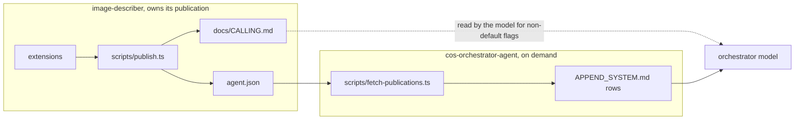

# Publish and fetch

Two scripts, two owners, one contract between them: the sibling's `agent.json`.



- The sibling never reads anything from the orchestrator and does not care whether the orchestrator is up to date.
- The orchestrator never imports sibling code and never runs the sibling's publish. It trusts the published `agent.json` and only checks that it is well formed.

## Publish (sibling side)

New [`image-describer/image-describer/scripts/publish.ts`](image-describer/image-describer/scripts/publish.ts), with `"publish:agent": "node --experimental-strip-types scripts/publish.ts"` in its `package.json`. A future sibling copies the file; no shared dependency.

**Reading the code.** It does not regex the source. It imports each extension listed in [`settings.json`](image-describer/image-describer/settings.json) `extensions` (strip `+`, resolve from the agent home) and calls the default export with a stand-in `pi`:

- `registerCommand(name, { description })` records a slash command.
- `registerTool({ name, description, parameters })` records a tool and the top-level `parameters` properties (name plus `description`).
- Every other method is a no-op through a `Proxy`. Handlers are never called, so nothing runs and nothing is billed.

Help text comes from one convention: the extension exports `HELP`, a map from command name to its help string, reusing the existing constant.

```ts
// image-describer/extensions/describe-images/index.ts
export const HELP = { "describe-images": DESCRIBE_HELP };
```

A command without a `HELP` entry is published with its description only. The orchestrator's own extension gets `export const HELP = { ask: ASK_HELP, usage: USAGE_HELP };` too, so it follows the same convention if it ever publishes.

**What it writes.**

- [`docs/CALLING.md`](image-describer/image-describer/docs/CALLING.md): one block between `<!-- BEGIN GENERATED: commands -->` and `<!-- END GENERATED: commands -->`, holding `## Slash commands` (name, description, `HELP` in a code block) and `## Tools (chat model only)` (name, description, parameter list). Text outside the markers is never touched. On the first run the block replaces the hand-written `## Flags for one run` section. If the markers are missing, the block is appended.
- [`agent.json`](image-describer/image-describer/agent.json): the script owns `commands` (`[{ "name": "/describe-images", "description": "..." }]`) and `tools` (same shape). Every other key, and its order, is preserved. 2-space JSON, trailing newline.

**Reliability.**

- A file is written only when its text changes. Output is `[ok] unchanged <path>` / `[ok] updated <path>`, or `[FAIL] <reason>` with exit code 1.
- Both files are computed in full before either is written, so a failure never leaves a half-updated publication.
- `--check` writes nothing and exits 1 when either file would change.
- The sibling's `npm test` runs a test that calls publish in check mode on the real agent home. Adding a command without running `npm run publish:agent` fails the sibling's own tests.

## Fetch (orchestrator side)

New [`cos-orchestrator-agent/cos-orchestrator-agent/scripts/fetch-publications.ts`](cos-orchestrator-agent/cos-orchestrator-agent/scripts/fetch-publications.ts), with `"fetch:publications"` in its `package.json`. Run on demand for now.

**Source.** Every `~/pi-agents-experts-grouped/*/*/agent.json` except the orchestrator's own home, sorted by `name`. It reads JSON only.

**Validation.** Each publication must have `name`, `launcher`, and `defaultPrompt` as non-empty strings, and `commands` as an array. Any invalid publication stops the run with `[FAIL] <path>: <problem>` before anything is written. A stale publication is not detectable here and is the sibling's responsibility.

**Hand-owned keys the sibling adds.** `purpose`, any paths (`inbox`, `latestRun`, `contract`), and one new optional key, `call`, for the call as the orchestrator should show it, since code cannot infer `[--dir <abs path>]`:

```json
"call": "/describe-images [--dir <abs path>]"
```

Without `call`, the row uses `defaultPrompt`.

**Row format** in [`APPEND_SYSTEM.md`](cos-orchestrator-agent/cos-orchestrator-agent/APPEND_SYSTEM.md), between `<!-- BEGIN GENERATED: siblings -->` and `<!-- END GENERATED: siblings -->`. The heading, the delegation rules, the table header, and the closing fallback line stay hand-written outside the markers.

- `Sibling`: `name`.
- `Home`: the folder holding `agent.json`, written with `~`.
- `Call`: `` `<launcher> -p "<call or defaultPrompt>"` ``.
- `Does`: `purpose`, then `Other commands: /a, /b.` when `commands` lists more than the default one, then `Latest run: ...` when `latestRun` is set, then `Contract: docs/CALLING.md in its home.`

Command names only, never help text. The table is re-sent with every request: after the first turn it is mostly read from the provider's cache at a small fraction of the input price, but every change to it costs full price once.

Same write rules as publish: written only on change, `[ok] unchanged` / `[ok] updated`, `--check` mode.

## Tests

- image-describer `test/publish.test.ts`: `--check` on the real home passes. A temporary fixture agent (fake extension, `settings.json`, `agent.json`, `CALLING.md` with prose around the markers) checks that the first run updates both files, a second run reports unchanged, prose outside the markers survives, hand-owned keys survive, and a newly registered command makes `--check` fail.
- orchestrator `test/fetch-publications.test.ts`: two fixture siblings and a fixture `APPEND_SYSTEM.md`. Checks sorted rows, `call` overriding `defaultPrompt`, `Other commands` only when there are extra commands, prose outside the markers kept, the orchestrator's own home skipped, and a publication missing `launcher` failing without any write.

## First run

1. Add `export const HELP` to both extensions.
2. In image-describer's `agent.json`, add `call` and set `purpose` to the current `Does` sentence from the table, so the generated row reads like today's.
3. `npm run publish:agent` in image-describer, review `CALLING.md` and `agent.json`.
4. `npm run fetch:publications` in the orchestrator, review `APPEND_SYSTEM.md`.

## Correct the billing claims

What Pi 1.4.0 actually does, checked in `node_modules/@earendil-works/pi-coding-agent` and in the orchestrator's session files:

- `APPEND_SYSTEM.md` and `AGENTS.md` are read at startup and on `/reload` only (`resource-loader.js`). An edit mid-session does nothing until then.
- Every request still carries the full system prompt plus the whole conversation; the provider APIs are stateless.
- The provider caches repeated prompt prefixes on its side. Recorded deepseek-flash turns show cache reads growing (640, then 3,200, up to 8,448 tokens) while uncached input stays at roughly 150 to 400 tokens.
- Cache reads cost 2% of input for deepseek-flash, 10% for gemini-3.8-flash, and 5% for gpt-6.1-sol (`models-store.json`). The first turn of a session, a turn after the cache expires, and any text after a changed point are billed at the full input price.

Text changes, wording only:

- [`cos-orchestrator-agent/AGENTS.md`](cos-orchestrator-agent/cos-orchestrator-agent/AGENTS.md) lines 13-14, replace with:
  `- Every turn re-sends the system prompt, this file, the environment notes, and the whole conversation so far. The provider bills text it has cached from earlier turns at a small fraction of the input price; new text is billed in full.`
  The next bullet ("Context is the budget...") stays: a longer conversation still costs more each turn.
- [`docs/CHEATSHEET.md`](cos-orchestrator-agent/cos-orchestrator-agent/docs/CHEATSHEET.md) line 11: `prompt (short on purpose: it is re-sent with every turn)`.
- `docs/CHEATSHEET.md` line 45: `` `Sibling agents` table in `APPEND_SYSTEM.md` (re-sent with every turn, mostly at cached rates: one row per sibling) ``.
- `docs/CHEATSHEET.md`: a short `## Prompt caching` section after `## Tokens are facts, cost is an opinion`, listing the four findings above in plain sentences.
- [`APPEND_SYSTEM.md`](cos-orchestrator-agent/cos-orchestrator-agent/APPEND_SYSTEM.md) line 14 and [`image-describer/docs/CALLING.md`](image-describer/image-describer/docs/CALLING.md) line 12, "bills its whole prompt" becomes: `starts the sibling's chat model, which sends its whole prompt as a new session`. A launched sibling is a new process, so its first request is mostly uncached. The `CALLING.md` line is outside the generated markers, so publish leaves it alone.

## Later, not in this plan

- An orchestrator extension that runs fetch once from `session_start`. The new rows take effect on the next launch, since the current session's system prompt is already built.
- Optionally, a sibling extension that runs publish at its own session start.
