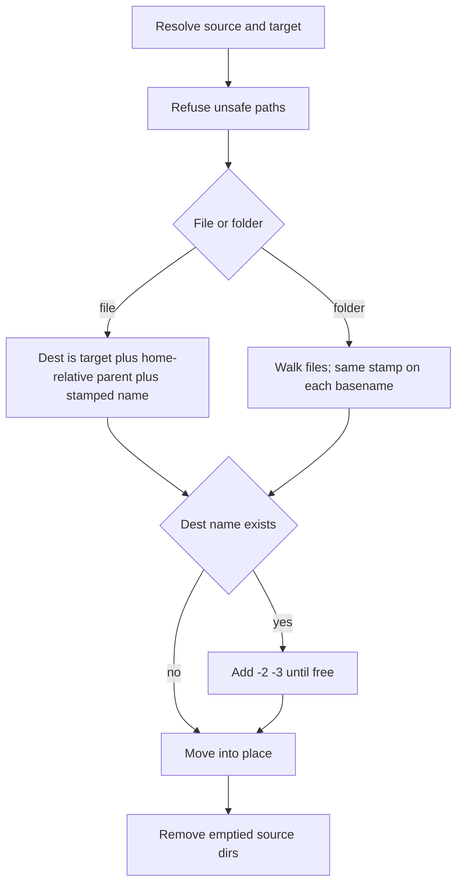

# Archive full-tree move

A Python CLI in [apps-scripts/archive-to-target-full-tree/archive-to-target-full-tree](apps-scripts/archive-to-target-full-tree/archive-to-target-full-tree) moves deprecated files and folders into an archive. The path under home is rebuilt under the target, and every moved filename gets one shared timestamp so a later move into an existing tree cannot overwrite.

No slash command in this task. The CLI is what a later slash command or agent will call.

## Locked behavior

Source `~/.pi/agent/example.md`, target `~/.pi/archive`, stamp `2026-11-02T17-24-16-219` lands at:

`~/.pi/archive/.pi/agent/2026-11-02T17-24-16-219_example.md`

- The preserved path is relative to `$HOME`, so `.pi` stays in the archived path.
- One stamp per run, local time, format `YYYY-MM-DDTHH-MM-SS-mmm`, applied as `{stamp}_{original name}`.
- Folder names are not stamped. A folder source is walked and every file inside is moved with the same stamp. Empty directories are recreated under the target, then removed from the source.
- If `archive/.pi/agent/` already exists, files merge into it. This is a real move (`shutil.move`): the source path is removed after success.
- Never overwrite. If that stamped name already exists, use `{stamp}-2_`, `{stamp}-3_`, and so on.
- Do not resolve symlinks. A symlink is moved as itself. Directory symlinks are not followed.



## Files

- [archive_to_target_full_tree.py](apps-scripts/archive-to-target-full-tree/archive-to-target-full-tree/archive_to_target_full_tree.py) — CLI and move logic, stdlib only (`argparse`, `pathlib`, `shutil`, `json`, `datetime`). Shebang `python3`.
- [archive-to-target-full-tree.config.json](apps-scripts/archive-to-target-full-tree/archive-to-target-full-tree/archive-to-target-full-tree.config.json) — defaults, not hardcoded in the script. Section name is the task; fields stay short:

```json
{
  "archiveToTargetFullTree": {
    "target": "~/.pi/archive",
    "sources": []
  }
}
```

- [test_archive_to_target_full_tree.py](apps-scripts/archive-to-target-full-tree/archive-to-target-full-tree/test_archive_to_target_full_tree.py) — `unittest` (no pytest dependency) using `tmp_path`-style temp dirs.

## CLI

```text
archive_to_target_full_tree.py [--config FILE] [--list FILE] [--source PATH ...] [--target DIR] [--dry-run]
```

- `--target` overrides the config target. `--source` (repeatable) replaces the config source list for this run. With neither `--source` nor `--list`, the script uses `sources` from the default config.
- `--list FILE` reads another JSON file with the same `archiveToTargetFullTree` shape and uses its `sources`. `--target` still overrides. `--source` still replaces that list when both are passed.
- Default `--config` is the JSON file beside the script. Missing target after override resolution is a `[FAIL]` and exit 1. No path is hardcoded in the script.
- `--dry-run` prints each planned `source -> dest` and does not move or delete anything.
- Lines are `[ok]` or `[FAIL]` with the two absolute paths. Exit 0 only when every entry succeeded.
- An explicit `--source` that does not exist is `[FAIL]` (a typo should be loud). A list or config entry that does not exist is `[ok]` skipped, so the same list can be run again after the first move.
- One bad entry does not stop the rest. Exit 1 if any entry failed.

## Refusals

- Source is not under `$HOME`.
- Source is inside the target, the target is inside the source, or they are the same path. This blocks moving `~/.pi` into `~/.pi/archive`.
- Destination parent cannot be created, or the move itself fails: `[FAIL]` that entry, leave already-moved siblings where they are, continue the batch.
