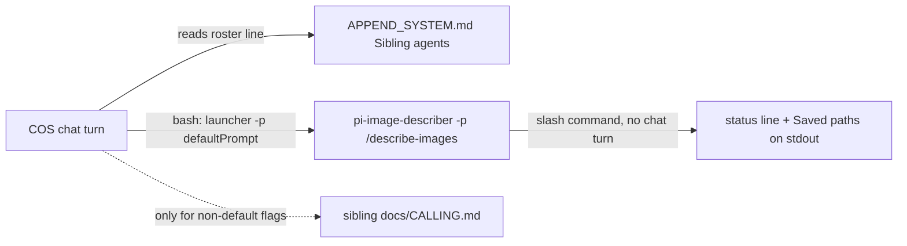

# COS sibling roster and cleanup

## How delegation works after this



The sibling already knows how to behave. The COS only needs three things per sibling: the launcher, the default prompt (always a slash command), and where its flags are written down.

## 1. Sibling manifest (owned by each sibling)

New file `image-describer/image-describer/agent.json`:

```json
{
  "name": "image-describer",
  "launcher": "pi-image-describer",
  "defaultPrompt": "/describe-images",
  "purpose": "Describe every new image in the inbox; writes <image>.md beside each image.",
  "inbox": "~/pi-agents-experts-grouped/image-describer/images",
  "latestRun": "~/pi-agents-experts-grouped/image-describer/image-describer/front-and-center.md",
  "contract": "~/pi-agents-experts-grouped/image-describer/image-describer/docs/CALLING.md"
}
```

Every future sibling ships the same file at `<repo>/<agent-home>/agent.json`. That is the convention for adding an agent.

## 2. Calling contract (owned by each sibling)

New file `image-describer/image-describer/docs/CALLING.md`, caller-only and short (about 30 lines), taken from [CHEATSHEET.md](image-describer/image-describer/docs/CHEATSHEET.md):
- the default call, with and without `--dir`
- the flags a caller uses: `--dir`, `--mode`, `--model`, `--effort`, `--language`, `--prompt`, `--timeout`
- the save flags, in one line
- the output contract: in `-p` mode, descriptions are not printed; the status line and `Saved` paths are; `[FAIL]` goes to stderr
- the inbox rule: one UUID subfolder per image
- where to read results: `front-and-center.md`, and the sibling `.md` files

Leave out the dashboard, the HTTP API, and maintenance.

## 3. COS roster section (static text, no code)

Add a `## Sibling agents` section to [APPEND_SYSTEM.md](cos-orchestrator-agent/cos-orchestrator-agent/APPEND_SYSTEM.md):
- The rule: call a sibling as `<launcher> -p "<defaultPrompt> [flags]"`. Never send natural language when a slash command covers the task. Never run a sibling's `--help` or read its source. Read `CALLING.md` only when you need a flag beyond the default.
- One line per sibling, mirroring its `agent.json`. For image-describer: launcher, default prompt, purpose, inbox, `latestRun`, and the contract path.
- One sentence for new siblings: their manifests are at `~/pi-agents-experts-grouped/*/*/agent.json`.

Adding an agent later means: add its folder, `agent.json`, and `CALLING.md`, then one roster line here.

## 4. Fix stale paths: image-describer

- [src/env.ts](image-describer/image-describer/src/env.ts): change the fallback from `~/image_describer/image-describer` to `~/pi-agents-experts-grouped/image-describer/image-describer`. Check [test/dashboard.test.ts](image-describer/image-describer/test/dashboard.test.ts), which has 2 references, and update it if it asserts on that path.
- [APPEND_SYSTEM.md](image-describer/image-describer/APPEND_SYSTEM.md): fix the agent home and `.env` paths.
- [docs/CHEATSHEET.md](image-describer/image-describer/docs/CHEATSHEET.md): fix 12 references, and link to `CALLING.md`.
- [README.md](image-describer/image-describer/README.md): fix 5 references.
- Leave `docs/deploy on VPS.md` alone; it probably describes a different host layout. I'll flag it rather than change it.

## 5. Fix stale paths and contradictions: COS

- [ledger/env.ts](cos-orchestrator-agent/cos-orchestrator-agent/ledger/env.ts): change the fallback from `~/chat_meter/chat-meter` to the grouped agent home.
- [src/ask.ts](cos-orchestrator-agent/cos-orchestrator-agent/src/ask.ts) line 77: point the error message at `~/pi-agents-experts-grouped/cos-orchestrator-agent/.env`.
- [extensions/chat/index.ts](cos-orchestrator-agent/cos-orchestrator-agent/extensions/chat/index.ts): update the header comment to name the COS agent.
- Leave the internal identifiers alone: `customType: "chat-meter"`, the package name, and the test fixtures. Old session files and the ingest code depend on them.
- Remove the duplication between the two prompt files, both of which are billed every turn:
  - [AGENTS.md](cos-orchestrator-agent/cos-orchestrator-agent/AGENTS.md) keeps the role and how to answer.
  - [APPEND_SYSTEM.md](cos-orchestrator-agent/cos-orchestrator-agent/APPEND_SYSTEM.md) keeps the environment, the tools (listed once), and the sibling roster.
  - Remove the tool list repeated across both files.
- [docs/CHEATSHEET.md](cos-orchestrator-agent/cos-orchestrator-agent/docs/CHEATSHEET.md) and [README.md](cos-orchestrator-agent/README.md): add a short "Sibling agents" note on the manifest convention.

## 6. Verify

- Run `npm test` and `npm run typecheck` in both agent homes.
- Run `rg "image_describer|chat_meter"`. It should return only `deploy on VPS.md` and the deliberately kept identifiers.
- Do a live check in the COS: "describe the new image in the inbox". Expect exactly one bash call, `pi-image-describer -p "/describe-images"`, and no new chat-model rows in the image-describer session.

Both agents are separate git submodules. I won't commit unless you ask.
