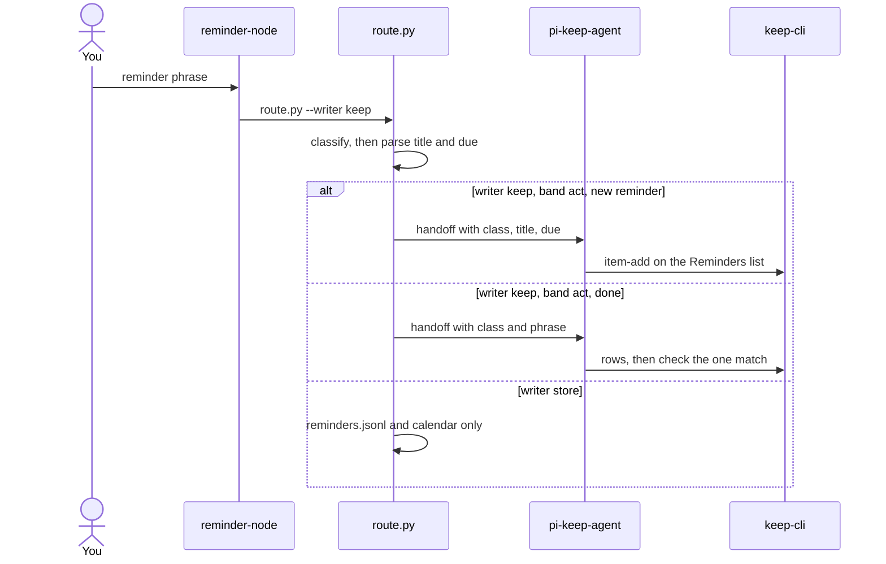

# Exclusive reminder writers

> Cancelled 2026-11-07. keep-agent and keep-cli were removed and must not be restored. Do not execute this plan.

`reminderNode.writes` becomes a single choice. A reminder runs one writer. The other is not called.

How others do this: the router keeps classification and the parsed fields, and does not send its reasoning. The specialist that owns the store gets a fresh instruction with the class and those fields. Create is an insert of the already-parsed text. Complete is search-then-check, because the open items live in the external list, not in the router. A plain Keep note cannot be checked off. `keep-cli --check` ticks a list row, so both operations use one list named `Reminders`.

## Config

In [`config.json`](/home/pmpmt/.pi/config.json), replace `writes` with `"writer": "keep"`. The only other value is `"store"`. A missing or other value routes nowhere: classification and `verdicts.jsonl` still happen, and the turn reaches the model. `enabled`, `print`, and `mode` stay as they are. `mode: "dry"` still classifies and executes nothing.

[`src/global-config.ts`](/home/pmpmt/.pi/agent/cos-orchestrator-agent/src/global-config.ts) reads `writer` only when it is the string `keep` or `store`. The extension passes `--writer` into [`route.py`](/home/pmpmt/.pi/decision-nodes/reminder/route.py). A hand run with no flag stays on `store`, so the shell does not follow the config file.

## Router

[`decision-nodes/reminder/config.py`](/home/pmpmt/.pi/decision-nodes/reminder/config.py) `router()` branches once:

- `store`: today's `do:reminder:log`, `do:reminder:calendar`, and `do:reminder:done`.
- `keep`: `do:reminder:keep` or `do:reminder:keep-done`.
- Hint bands stay `hint:reminder` and `hint:reminder_done` for both writers. Nothing is written, and the model asks.

`do:reminder:keep` uses the existing extractor. On success it starts `pi-keep-agent -p` with one instruction: class `reminder`, the parsed title, the due time, and the exact row text. The agent appends that row to the Keep list `Reminders` (`--item-add`, or `--add-list` when the list is missing). It does not create a calendar event or touch `reminders.jsonl`.

`do:reminder:keep-done` sends class `reminder_done` and the phrase. The agent lists rows on `Reminders` and runs `--check` on the single match. Zero or several matches check nothing and come back as `no-match`.

The store destinations and the keep destinations are separate lists. One call of `router()` returns only one of those lists.

## Guard

keep-agent's contract says it loads no extensions, but `extensions/reminder-node` is on disk in that home. A keep turn must not load it: with `writer: keep` that would call `pi-keep-agent` again. Before wiring the handoff, confirm the process does not load that extension and take it off the load path if it does. The handoff text is an instruction, not a second copy of the user's phrase.

## Turn result

[`extensions/reminder-node/index.ts`](/home/pmpmt/.pi/agent/cos-orchestrator-agent/extensions/reminder-node/index.ts) finishes the turn only when the selected writer's `do:reminder:` route actually ran. A hint, a downgrade, or a done with no single match still leaves the turn to the model. Outcome lines in [`src/reminder-node.ts`](/home/pmpmt/.pi/agent/cos-orchestrator-agent/src/reminder-node.ts) report the Keep row that was added or checked.

## Tests and docs

Update the router tests so `keep` and `store` each return only their own destinations, and an unknown writer returns none. Update the config-reader tests for `writer`. Document the switch in the reminder runbook, [`docs/reference/reminder-node-enabled.md`](/home/pmpmt/.pi/agent/cos-orchestrator-agent/docs/reference/reminder-node-enabled.md), and the keep-agent calling note. Mark the inbox item that allowed both writes in sequence as replaced by this choice.