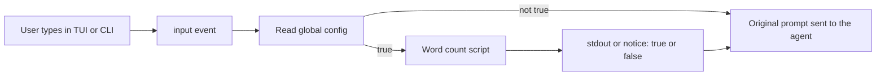

# Word-count answer before each orchestrator prompt

Target agent is cos-orchestrator, not web-master. Pi loads [cos-orchestrator-agent/cos-orchestrator-agent/extensions/chat/index.ts](cos-orchestrator-agent/cos-orchestrator-agent/extensions/chat/index.ts) for the whole session. A second extension on the `input` event sees the raw TUI or CLI string after slash commands are skipped and before `before_agent_start` sends the turn to the model.

The check runs only when a global flag is enabled. Every turn reads that file again. If the file is missing, the key is missing, the JSON is invalid, or the value is not the boolean `true`, the check stays off and the prompt goes to the agent with no true/false line.



## Global config

Create [config.json](config.json) at the grouped repo root, one level above the orchestrator submodule. [ledger/env.ts](cos-orchestrator-agent/cos-orchestrator-agent/ledger/env.ts) already resolves the agent home from `PI_CODING_AGENT_DIR`; the config path is `path.join(repoRoot(env), "..", "config.json")`.

```json
{
  "lessThanSixWords": false
}
```

`false` is the on-disk default. The reader still treats a missing file the same way, so a checkout without the file stays disabled.

## Script

Add [cos-orchestrator-agent/cos-orchestrator-agent/src/less-than-six.ts](cos-orchestrator-agent/cos-orchestrator-agent/src/less-than-six.ts):

- Split the string on whitespace and drop empty pieces.
- Fewer than 6 words prints `true`. Six or more prints `false`.
- A blank string is 0 words, so `true`.

The same file is the CLI: read the string from stdin and write only `true` or `false` plus a newline to stdout. No other text.

## Session hook

Add [cos-orchestrator-agent/cos-orchestrator-agent/extensions/less-than-six/index.ts](cos-orchestrator-agent/cos-orchestrator-agent/extensions/less-than-six/index.ts) and register `+extensions/less-than-six/index.ts` in [settings.json](cos-orchestrator-agent/cos-orchestrator-agent/settings.json) next to the chat extension.

On each `input`:

- Ignore `event.source === "extension"` so injected messages are not counted again.
- Read `lessThanSixWords` from the global file. Continue immediately unless the value is boolean `true`. A read error does not fail the turn.
- When enabled, run the check on `event.text`.
- Print mode (`ctx.hasUI === false`): write the answer with `writeSync` to file descriptor 1, because Pi sends `console` to stderr in print mode.
- TUI and RPC: `ctx.ui.notify` with only `true` or `false`.
- Return `{ action: "continue" }` so the original prompt still goes to the agent.
- Slash commands such as `/ask` and `/usage` never hit `input`, so they stay unchanged.

## Test

Add a node test for short, long, spaced, and empty strings, and for the config reader: explicit `true`, explicit `false`, a missing file, a missing key, and invalid JSON. Only explicit `true` enables the check.
