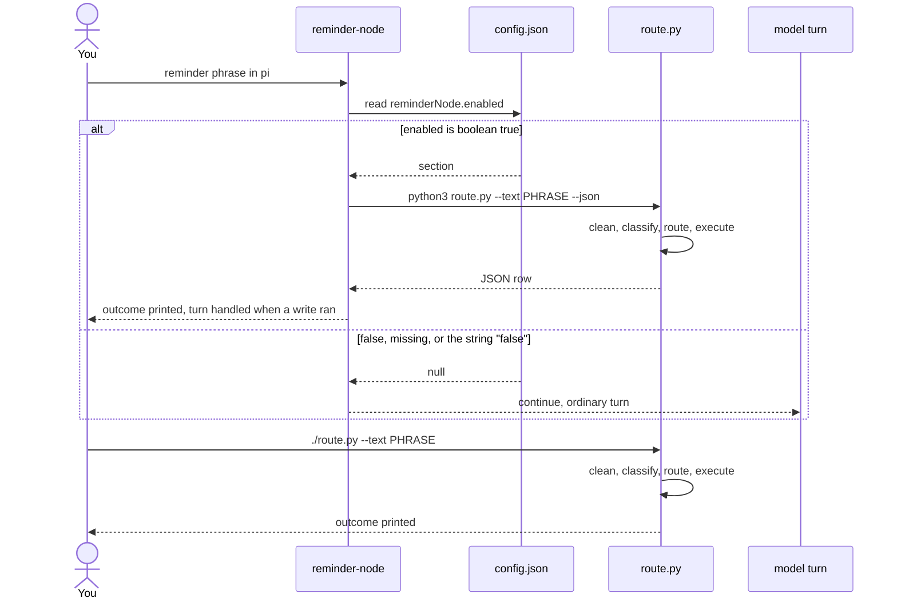

# Trace of `reminderNode.enabled`

> 2026-11-06. `reminderNode.enabled` is checked before anything else. Only the boolean `true` calls `route.py`. Boolean `false`, a missing field, and the string `"false"` all stop at the same place.

- The check is `enabled !== true` in `readEnabledSection`. Boolean `false`, no `enabled` field, the string `"false"`, a missing section, and unreadable JSON all return `null`. The extension returns `continue` before classification and before `route.py`. `print`, `mode`, and `writer` are unread on that path.
- `./route.py --text` never opens `config.json`. It starts at `clean` and follows the write path from there. `--dry-run` stops after routing. `--writer store|tasks|off` selects the destination (`--no-writes` / `REMINDER_WRITER=off` is off). `--list`, `--done`, and `--undo` are explicit store-table commands and run either way.
