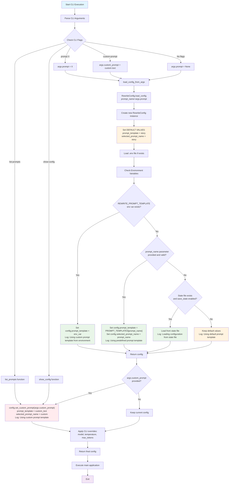

# Prompt Template Usage Flow Chart

This document provides a detailed flowchart showing how prompt templates are selected and used in the text_rewrite package.

## Flow Chart



## Priority Order

The prompt template selection follows this priority order (highest to lowest):

1. **Custom Prompt** (`--custom-prompt` flag)
   - **File**: `src/text_rewrite/cli.py:137`
   - **Method**: `config.set_custom_prompt(args.custom_prompt)`
   - **Result**: `selected_prompt_name = 'custom'`

2. **Environment Variable** (`REWRITE_PROMPT_TEMPLATE`)
   - **File**: `src/text_rewrite/config/text_rewrite_config.py:121-123`
   - **Result**: Uses custom template from environment

3. **CLI Argument** (`--prompt` flag)
   - **File**: `src/text_rewrite/config/text_rewrite_config.py:124-127`
   - **Result**: Uses predefined template from `PROMPT_TEMPLATES`

4. **Saved State File** (`.text_rewrite_state.json`)
   - **File**: `src/text_rewrite/config/state_manager.py`
   - **Result**: Uses last saved configuration

5. **Default** ('story')
   - **File**: `src/text_rewrite/config/text_rewrite_config.py:60,65`
   - **Result**: Falls back to default 'story' template

## Code Locations

### Initial Default Values
- **File**: `src/text_rewrite/config/text_rewrite_config.py`
- **Line 60**: `self.prompt_template = PROMPT_TEMPLATES['story']`
- **Line 65**: `self.selected_prompt_name = 'story'`

### Configuration Loading
- **File**: `src/text_rewrite/config/text_rewrite_config.py`
- **Lines 119-129**: Prompt template selection logic
- **Line 125**: `config.prompt_template = PROMPT_TEMPLATES[prompt_name]`
- **Line 126**: `config.selected_prompt_name = prompt_name`

### CLI Processing
- **File**: `src/text_rewrite/cli.py`
- **Line 133**: `config = RewriteConfig.load_config(prompt_name=args.prompt)`
- **Line 137**: `config.set_custom_prompt(args.custom_prompt)`

### Custom Prompt Method
- **File**: `src/text_rewrite/config/text_rewrite_config.py`
- **Lines 143-147**: `set_custom_prompt()` method
- **Line 145**: `self.prompt_template = prompt_template`
- **Line 146**: `self.selected_prompt_name = 'custom'`

## Example Scenarios

### Scenario 1: No flags provided
```
python -m text_rewrite
```
**Result**: Uses default 'story' template (lines 60, 65)

### Scenario 2: Specific prompt flag
```
python -m text_rewrite --prompt grammar
```
**Result**: Uses 'grammar' template (lines 125, 126)

### Scenario 3: Custom prompt flag
```
python -m text_rewrite --custom-prompt "Translate to French: {text}"
```
**Result**: Uses custom template (lines 145, 146)

### Scenario 4: Environment variable set
```
set REWRITE_PROMPT_TEMPLATE="Custom template: {text}"
python -m text_rewrite
```
**Result**: Uses environment template (lines 121-123)

### Scenario 5: Multiple sources (priority applies)
```
set REWRITE_PROMPT_TEMPLATE="Env template: {text}"
python -m text_rewrite --prompt grammar --custom-prompt "Custom: {text}"
```
**Result**: Uses custom prompt (highest priority - lines 145, 146)

## Key Decision Points

1. **Environment Variable Check** (Line 120)
   - If `REWRITE_PROMPT_TEMPLATE` exists, use it
   - Overrides CLI arguments but not custom prompt

2. **CLI Argument Check** (Line 124)
   - If `--prompt` flag provided and valid, use it
   - Only applies if no environment variable

3. Line 145: **Custom Prompt Override**
   - If `--custom-prompt` flag provided, override everything
   - Highest priority in the system

4. **Default Fallback** (Line 129)
   - If no other sources, use default 'story' template
   - Set in lines 60 and 65 during initialization

## Logging Output

The system provides clear logging for each decision:
- "Using custom prompt template from environment variable"
- "Using predefined prompt template: {prompt_name}"
- "Using default prompt template: {config.selected_prompt_name}"
- "Using custom prompt template"

This logging helps trace which template source was actually used in the final configuration.
