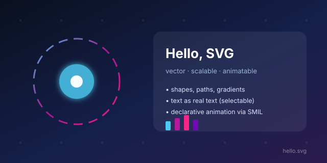

# svg-demo

A minimal, self-contained SVG demo: gradient background, dotted grid, dashed ring that
rotates, a pulsing core with a Gaussian glow, a frosted card with live text, and a tiny bar
chart. Everything is one file with no external assets, no fonts to download, and no scripts.

```
svg-demo/
├── hello.svg      # the artifact (generated — do not hand-edit)
├── make_svg.py    # generator, Python 3 stdlib only
└── README.md
```

## View it

```bash
firefox ~/.pi/apps-scripts/svg-demo/hello.svg

# or embed in HTML — SVG stays crisp at any size
# 
```

To rasterise to PNG, whatever is installed:

```bash
rsvg-convert -w 1280 hello.svg -o hello.png     # librsvg
inkscape hello.svg --export-filename=hello.png  # Inkscape
python3 -c "import cairosvg; cairosvg.svg2png(url='hello.svg', write_to='hello.png')"
```

None of those three are installed on this laptop today (`firefox` is), so a PNG needs one of
them installed first.

## Regenerate

```bash
cd ~/.pi/apps-scripts/svg-demo
python3 make_svg.py                      # writes hello.svg beside the script
python3 make_svg.py --title "Hi there"   # change the headline
python3 make_svg.py --out /tmp/x.svg     # write somewhere else
```

Output is deterministic: no timestamps, no randomness, so a rebuild is diff-clean. The script
parses its own output with `xml.etree` before writing, so a malformed SVG fails loudly instead
of landing on disk.

## What each part demonstrates

| Technique | Where in the file |
| --- | --- |
| `viewBox` + fixed `width`/`height` | root `<svg>` — scales without re-authoring |
| `<linearGradient>` | background wash, ring stroke |
| `<filter>` + `feGaussianBlur` + `feMerge` | glow behind the pulsing core |
| `stroke-dasharray` | the dashed ring |
| SMIL `<animateTransform>` | ring rotates, 12 s loop |
| SMIL `<animate>` on `r` | core pulses, 3 s loop |
| `<rect rx>` + `fill-opacity` via `opacity` | frosted card |
| real `<text>` (not paths) | selectable, searchable, restyleable |
| `<title>` + `aria-label` | accessible name for the graphic |

## Notes

- SMIL animation runs in Chrome, Firefox, and Safari but not in Internet Explorer, and some
  strict SVG rasterisers drop it — the graphic still renders, just static.
- Text uses a font stack (`Inter, Helvetica, Arial, sans-serif`), so no font file is embedded
  and the layout does not depend on Inter being present.
- `hello.svg` is generated. Edit `make_svg.py` and re-run rather than editing the SVG, or the
  next regeneration will silently discard the change.
